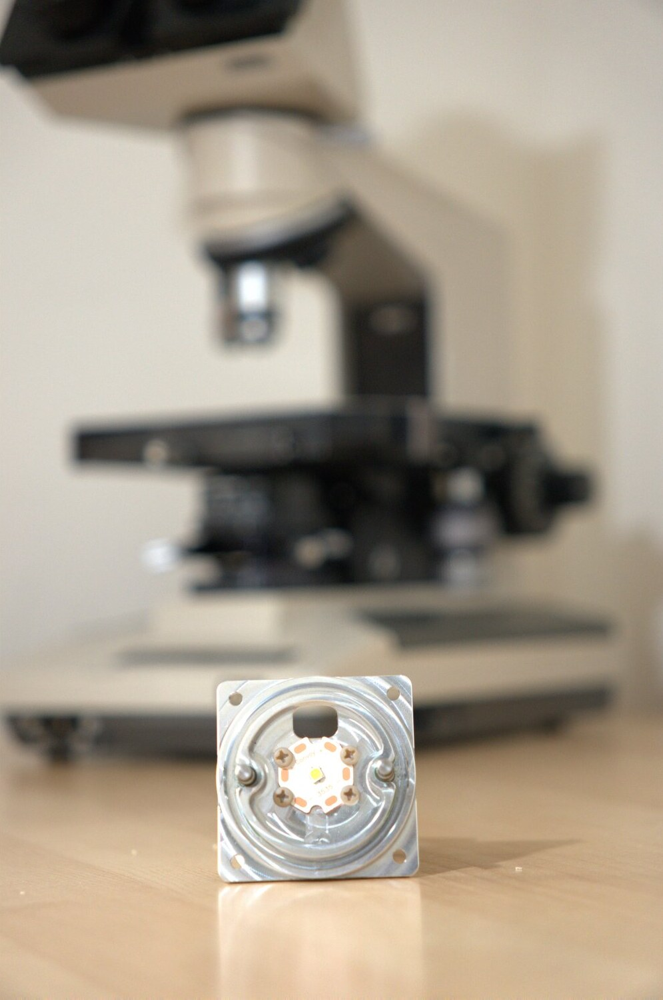
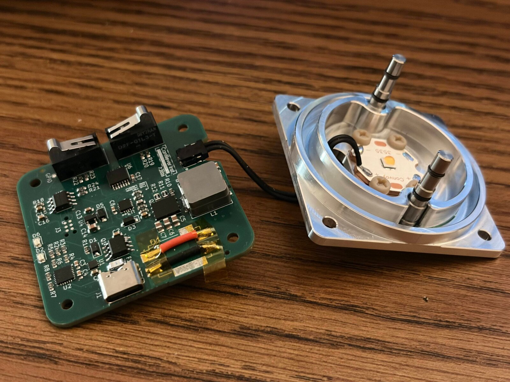
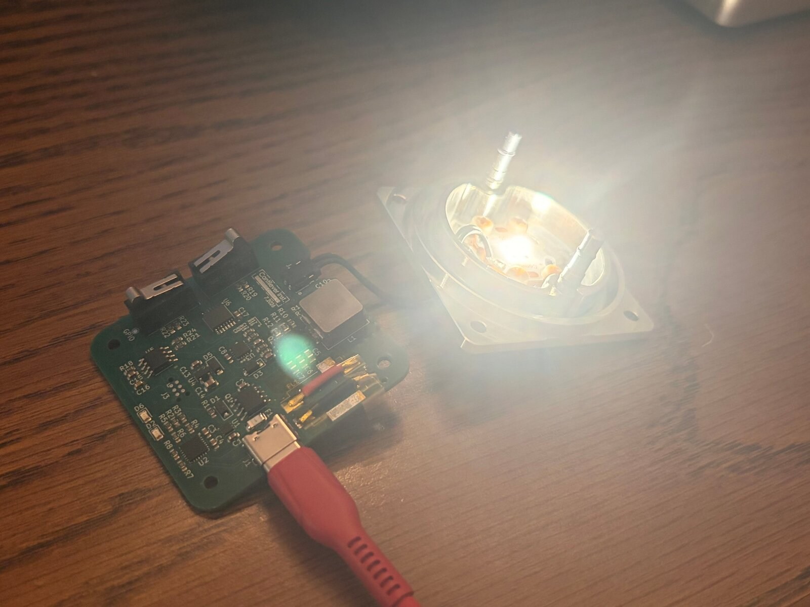

# USB-C PD High-CRI LED Driver

A compact, USB-C powered constant-current LED driver built around the Maxim **MAX20078** synchronous buck controller and an **STM32G031** microcontroller. It drives a high-CRI **Nichia 519A** emitter at up to **5 A**, with user-configurable control, saved settings, safety limits, and heavy input protection.

Built specifically to replace and upgrade the **discontinued halogen bulb assembly of Olympus BH2 lab microscopes**. It drops into the original lamp housing and swaps the hot, short-lived halogen bulb for a cool, efficient, high-CRI LED, while adding USB-C power, presets, and precise brightness control.

<p align="center">
  
</p>


## Photos

| Driver board and LED module | Running on USB-C PD |
|---|---|
|  |  |

## Features

- **USB-C Power Delivery input:** Infineon **CYPD3177** (EZ-PD BCR) sink controller negotiates a higher PD voltage from any USB-C charger
- **5 A constant-current buck:** MAX20078 synchronous buck LED controller with a BSG0811ND dual N-MOSFET power stage
- **High-CRI output:** tuned for the Nichia 519A for accurate color rendering
- **Smart dimming:** STM32 firmware handles smooth ramping, gamma-corrected brightness, off mode, and fault latching
- **User extensible:** open firmware so users can add their own macros, saved settings, and custom safety limits
- **Hardware-debounced buttons:** SR-latch debounce using SPDT switches and an SN74AC00 NAND gate
- **Fault handling:** the MAX20078 fault output is monitored and handled in firmware
- **Protection:** TVS clamping, fusing, EMI filtering, and gate/transient clamps
- **Custom CNC Nichia 519 Holder** Custom designed CNC 6061 Aluminum heatsink and male socket part that slides into the BHTU's rear illumination port with O-rings to prevent wear and ensure a tight friction fit.

## System Overview

```
USB-C ──► Fuse ──► TVS2200 ──► BNX025 EMI filter ──► CYPD3177 PD sink ──► VBUS load switch ──► VIN
                                                                                               │
                              ┌────────────────────────────────────────────────────────────────┤
                              ▼                                                                ▼
                    TPS7E82 LDO (3.3 V)                     MAX20078 buck ──► BSG0811ND ──► 4.7 µH ──► Nichia 519A
                              │                               ▲     │   ▲                                     │
                              ▼                               │     │   └── CSP/CSN current sense (shunt) ◄───┘
                     STM32G031 ─────── DIM (PWM) ─────────────┘     │
                        ▲    ◄─────────────────── FLT ──────────────┘
                        │
         SW1/SW2 (SPDT) ──► SN74AC00 SR-latch debounce
```

## Hardware

| Block | Part | Role |
|---|---|---|
| PD sink | Infineon CYPD3177-24LQ | Negotiates USB-C PD voltage; drives the VBUS load switch |
| Input protection | TI TVS2200DRV | Flat-clamp TVS on VBUS |
| EMI filter | Murata BNX025 | Input noise suppression |
| Fuse | F1 | Input overcurrent protection |
| LED controller | MAX20078ATE+T | Synchronous buck, constant-current LED regulation |
| Power stage | BSG0811ND dual N-MOSFET | High-side / low-side switches |
| Inductor | 4.7 µH | Buck output inductor |
| Current sense | 0.1 Ω shunt (Kelvin-routed CSP/CSN) | LED current feedback |
| MCU | STM32G031J6 | UI, settings, dimming, fault handling |
| LDO | TPS7E8233-Q1 | 3.3 V logic supply |
| Buttons | 2× Omron D2F-01F (SPDT) | User input |
| Debounce | SN74AC00 quad NAND | Cross-coupled SR latches |
| Emitter | Nichia 519A | High-CRI LED |

### Protection

- **Fuse** on the USB-C VBUS input
- **TVS2200** flat-clamp surge protection against hot-plug and ESD transients
- **Murata BNX025** EMI filter on the input to keep switching noise off the cable
- **Zener gate clamp** (MMSZ4702) on the VBUS load switch
- **Schottky diodes** (B340A, B5819W) for bootstrap and transient paths
- **Bulk and decoupling capacitance** (22 µF ceramics) on input and output
- **Dedicated current-sense net class** for accurate, low-noise regulation
- **Firmware limits** on maximum current and shutdown on fault

### Hardware Debounce

Each button is an SPDT switch wired to a cross-coupled NAND **SR latch** in the SN74AC00. The latch changes state on the first contact and ignores bounce, so the STM32 sees one clean edge on `ENCA` / `ENCB` per press without software debounce delays.

### Connectors & Test Points

| Ref | Description |
|---|---|
| J1 | USB-C power input (PD) |
| J2 | LED output (LED+, LED−) |
| J3 | TC2030 SWD programming / debug |
| TP1 | VDC |
| TP2, TP4 | GND |
| TP3 | GPIO (debug) |

## Firmware

Written in bare-metal C using the STM32 libraries (no RTOS). The STM32G031 provides:

- **PWM dimming:** TIM3 drives the MAX20078 `DIM` input with 32,000 steps of resolution
- **Smooth ramp:** hold up/down to sweep brightness over 3 s; level is computed from elapsed time so the sweep is exact
- **Perceptual curve:** square-law gamma so brightness changes look even across the range
- **Off mode:** hold down past minimum to turn fully off; press up to wake at minimum
- **Minimum on-time floor:** DIM pulses never drop below the width the current loop needs to settle
- **Fault handling:** `FLT` falling edge is confirmed by re-read, then latched; output is held at minimum (not released, which would let the DIM pull-up drive full brightness). Shutdown and wake-up `FLT` pulses are masked
- **Status LED:** blinks while adjusting, solid on a latched fault (clears on power cycle)
- **Software debounce** on top of the hardware latches, to reject switching-noise glitches

### Extending the Firmware

The firmware is meant to be customized. Users can add their own features, for example:

- **Macros / presets:** e.g. a double-press to jump to a saved brightness
- **Saved settings:** store the last level in flash and restore it on power-up
- **Custom safety limits:** cap the maximum duty for a given emitter or optics setup

| Pin | Function |
|---|---|
| PB0 | TIM3_CH3 PWM → MAX20078 DIM |
| PA12 | MAX20078 FLT (active low) |
| PA13 | Up button |
| PA15 | Down button |
| PB7 | Status LED (open drain) |

## Repository Layout

```
PCBfiles/
  CombinedLEDdriverMAX278.kicad_pro   KiCad project
  CombinedLEDdriverMAX278.kicad_sch   Top-level schematic (buck, MCU, LDO)
  usbc_input.kicad_sch                USB-C PD sink, fuse, TVS, EMI filter
  switches.kicad_sch                  Buttons and SR-latch debounce
Firmware/                             STM32G031 bare-metal C firmware
images/                               Photos used in this README
```

## Getting Started

1. Flash the STM32 over SWD using a TC2030 cable.
2. Connect the Nichia 519A to J2, observing polarity.
3. Plug in a USB-C PD charger capable of the required power.
4. Hold the up/down buttons to ramp brightness; hold down past minimum to turn off.

> Heat sink the emitter properly before running at full current.
